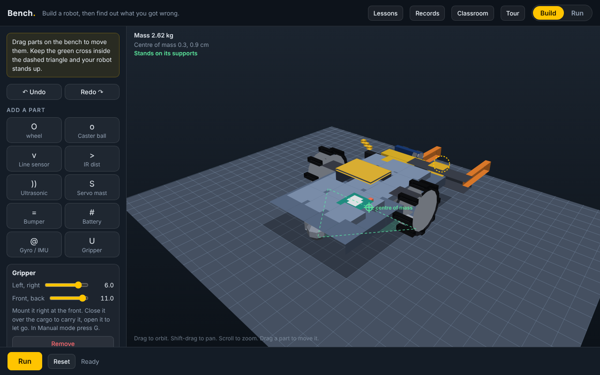

# Bench: Robotics Simulator

Bench is a build-a-robot sandbox that runs entirely in the browser. Design a robot in 3D, tune it, then race it through mazes, line tracks, hills, drag strips and delivery courses. It is one self-contained `index.html` with no frameworks and no build step.

## Run it

Open `index.html` in any modern browser, or serve the folder (for example with GitHub Pages).

## What you can do

- **Build:** wheels with five gear ratios, casters, line, IR and ultrasonic sensors, servo mast, bumper, gyro/IMU, encoder odometry, gripper, and four battery sizes. Parts can be moved, rotated, undone and redone.
- **Run:** challenges include maze, line lap, hill climb, drag race, obstacle course and payload delivery, on standard, tile, carpet and wet floors.
- **Control:** Manual, Tune (auto behaviours) and Rules modes.
- **Learn:** guided lessons, a first-visit tour, live telemetry graphs, ghost replay, personal bests and CSV export.
- **Teach:** a classroom mode that sets assignments and re-runs submitted builds to verify them.
- **Comfortable anywhere:** keyboard shortcuts and an on-screen touch pad for phones.

## Keyboard

| Key | Action |
| --- | --- |
| Space | Run / stop |
| Arrow keys | Nudge the selected part (Shift for bigger steps) |
| R / Shift+R | Rotate the selected sensor |
| Delete | Remove the selected part |
| Ctrl/Cmd+Z | Undo |
| Ctrl/Cmd+Shift+Z or Ctrl+Y | Redo |
| G | Gripper (Manual mode) |
| M | Sound on/off |

## Notes

- The gyro gives heading hold, turn angle and pitch; it does not model self-balancing.
- Saved builds, bests and settings live in your browser's local storage.
